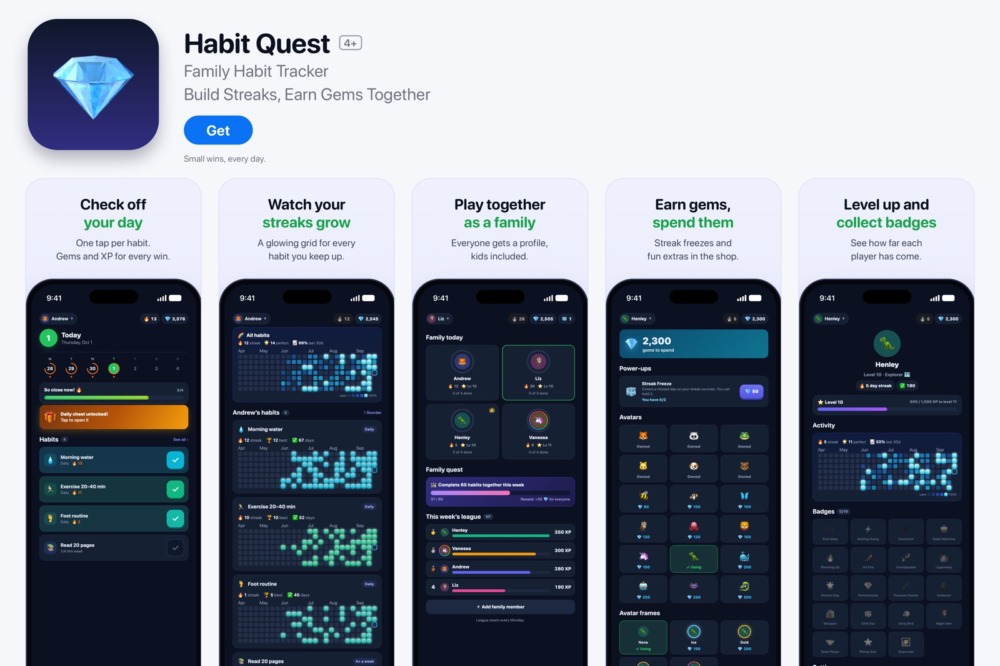

# Habit Quest

A family habit tracker with game mechanics: streaks, XP, gems, badges and a weekly family league.



## Features

- One tap to check off a habit; XP and gems for every completion
- Streaks, with a streak-freeze power-up bought with gems
- A profile for every family member, kids included
- A shared family quest and a weekly league that resets every Monday
- Levels, badges, avatars and avatar frames
- Installable on a phone home screen (web app manifest and icons)

## Tech

- **Front end:** a single HTML file with vanilla JavaScript and CSS (`deploy/index.html`), no build step
- **Back end:** Supabase (Postgres and Auth) with row-level security
- **Database:** `setup-habit-quest.sql` adds the `hq_*` tables. It shares a Supabase project with [The Board](https://github.com/Andrew-Codes-7/the-board), so a family signs in once and the same members appear in both apps
- **Hosting:** Netlify (`deploy/`)

## Running locally

```bash
python3 -m http.server 8793 --directory deploy
```

Then open <http://localhost:8793>.
